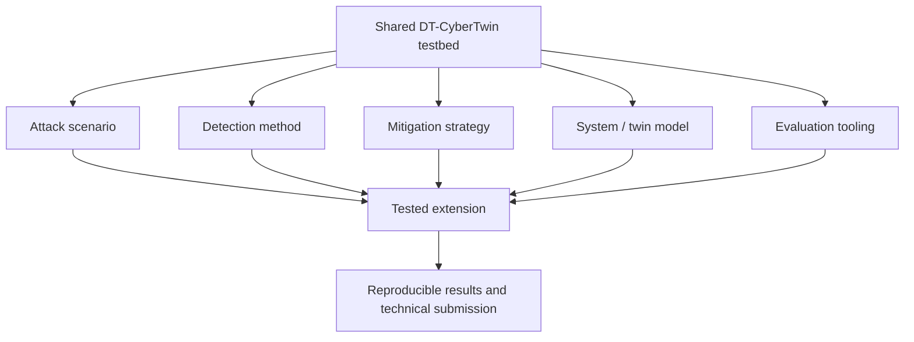
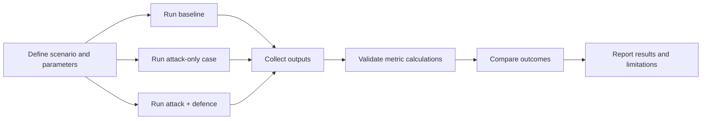
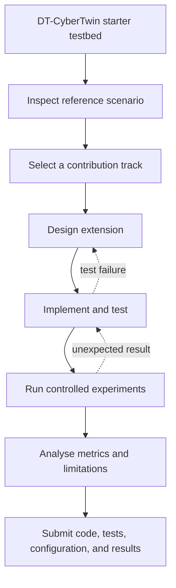

# DT-CyberTwin

## Hackathon Extension Framework and Student Contribution Guide

**Document purpose:** Define the role of the DT-CyberTwin starter
testbed, the contributions expected from hackathon participants, and the
capabilities needed to support safe, reproducible evaluation.

**Status:** Proposed framework\
**Project type:** Cybersecurity digital-twin testbed with an industrial
temperature-control case study

------------------------------------------------------------------------

## 1. Overview

DT-CyberTwin is a starter environment for exploring cybersecurity in
cyber-physical systems (CPS). It provides a simulated industrial
temperature-control scenario in which participants can inspect the
relationship between cyber assets, sensor telemetry, controller
behaviour, actuator actions, and physical process state.

The hackathon should use DT-CyberTwin as a shared foundation.
Participants are expected to extend the existing implementation with new
attack scenarios, detection mechanisms, mitigation strategies,
digital-twin models, or evaluation capabilities. They should not need to
rebuild the simulation engine or dashboard from scratch.

The intended workflow is:

**Starter testbed → Student-built extension → Controlled experiment →
Quantitative evaluation**

The emphasis is on engineering contributions that can be integrated,
tested, and evaluated---not simply on operating the existing dashboard.

## 2. Existing Foundation

The starter project is intended to provide the following reference
capabilities. Before the hackathon, the repository should be audited to
confirm the implementation and test status of each item.

-   **Cyber-physical topology:** A visual representation of cyber assets
    and the industrial control loop.
-   **Reference physical process:** An industrial temperature-control
    scenario.
-   **Baseline execution:** A reference run without the selected attack.
-   **Sensor-spoofing scenario:** A simulated case in which reported
    sensor telemetry is manipulated.
-   **Configurable parameters:** Scenario settings such as simulation
    duration, initial temperature, controller setpoint, safety limit,
    attack timestep, and spoof offset.
-   **Telemetry and impact views:** A way to inspect simulation outputs
    and selected impact metrics.
-   **Programmatic backend:** A foundation for extending scenario logic
    and running tests.

These capabilities form the starting point, not the expected limit of
participant work. Any feature not verified in the repository should be
treated as planned or unconfirmed rather than advertised as complete.

## 3. Student Contribution Model

Each team should select one primary contribution track. Teams may
integrate supporting work from other tracks where it is necessary to
demonstrate their main contribution.

### Track A --- Attack Scenario Engineering

**Objective:** Implement a new simulated attack against the
cyber-physical system.

Possible contributions include:

-   Replay of previously observed sensor telemetry.
-   Manipulation of controller setpoints.
-   Communication delay, disruption, or packet loss.
-   Manipulation of actuator commands.
-   Compromise of a simulated cyber asset or communication link.

**Expected deliverables:**

1.  A documented attack model and its assumptions.
2.  An implementation integrated with the scenario framework.
3.  Tests for attack activation, duration, and expected effects.
4.  Results comparing the attack with an appropriate baseline.

All attacks must remain within the simulated environment. Participants
must not target real industrial equipment or external systems.

### Track B --- Intrusion Detection and Anomaly Detection

**Objective:** Detect malicious or abnormal behaviour using available
simulation state and telemetry.

Possible contributions include:

-   Detection of disagreement between physical state and reported
    telemetry.
-   Threshold-based or rule-based anomaly detection.
-   Detection of stale, replayed, or inconsistent measurements.
-   Detection based on multiple signals rather than a single sensor
    value.

**Expected deliverables:**

1.  A documented detection method and its input signals.
2.  An implementation with defined alert conditions.
3.  Tests covering normal and attack conditions.
4.  Quantitative results, including detection rate and false-positive
    rate where applicable.

A detector should not be evaluated only on the attack scenario it was
designed around. Where feasible, it should also be tested against normal
operation and at least one different or varied attack condition.

### Track C --- Resilient Control and Mitigation

**Objective:** Reduce the physical or operational impact of a
cyberattack.

Possible contributions include:

-   Switching to a safe fallback when telemetry is untrustworthy.
-   Rejecting implausible sensor values.
-   Applying redundant-sensor checks or independent state estimates.
-   Introducing recovery logic after an attack ends.
-   Preventing unsafe actuator commands.

**Expected deliverables:**

1.  A documented mitigation strategy and its assumptions.
2.  An implementation connected to the simulated control loop.
3.  Tests showing the mitigation's activation and recovery behaviour.
4.  A comparison of attack-only and attack-with-mitigation results.

The evaluation should check for trade-offs. A mitigation that reduces
one safety risk but causes excessive downtime, instability, or false
alarms should report those effects.

### Track D --- Digital-Twin and System Modelling

**Objective:** Extend the simulated system or improve the fidelity and
clarity of its cyber-physical relationships.

Possible contributions include:

-   Adding a cyber asset or communication relationship.
-   Modelling a new sensor, controller, actuator, or physical process.
-   Representing communication properties such as delay or packet loss.
-   Improving the consistency between simulated physical state and
    reported measurements.
-   Adding a second reference process, if the scope and time available
    permit it.

**Expected deliverables:**

1.  A system model and explanation of its assumptions.
2.  An implementation that follows the project's extension interfaces.
3.  Tests for state transitions and component interactions.
4.  Evidence that the new model behaves as intended under defined
    conditions.

### Track E --- Security Evaluation and Experimentation

**Objective:** Improve the reproducibility, comparability, or analytical
value of testbed experiments.

Possible contributions include:

-   A repeatable experiment runner for baseline, attack, and defended
    runs.
-   Structured experiment records and configuration capture.
-   Additional impact metrics with clearly defined formulas.
-   Evaluation across multiple parameter settings or attack timings.
-   Automated comparison of results and generation of experiment
    summaries.

**Expected deliverables:**

1.  A documented experimental protocol.
2.  Reproducible runs with recorded configuration.
3.  Validated metric calculations.
4.  Results, limitations, and interpretation.

Teams in this track should improve the quality of evidence produced by
the testbed rather than report a metric without defining what it
measures.

### Contribution model at a glance

## 4. Recommended Experiment Protocol

Where applicable, student contributions should be evaluated through
three conditions:

  -----------------------------------------------------------------------
  Condition                           Purpose
  ----------------------------------- -----------------------------------
  **Baseline**                        Establish system behaviour without
                                      the selected attack.

  **Attack only**                     Measure the effect of the attack
                                      without the proposed defence.

  **Attack with defence**             Determine whether the student's
                                      detection or mitigation changes the
                                      outcome.
  -----------------------------------------------------------------------

For an attack-only contribution, the third condition may be replaced by
a comparison against a second attack configuration or another justified
reference condition.

Each experiment should record:

-   Scenario and implementation version.
-   Simulation parameters and safety thresholds.
-   Attack type, start time, duration, and configuration, where
    applicable.
-   Random seed, if stochastic behaviour is used.
-   Relevant telemetry and physical-state outputs.
-   Metrics, units, and calculation methods.
-   Test outcome, known limitations, and any failed runs.

A single successful run may demonstrate functionality, but it is
generally insufficient to establish robustness. Where the simulation
supports variation, teams should repeat runs across relevant parameter
settings and report the range or variability of results.

### Experiment comparison flow

## 5. Suggested Evaluation Metrics

Teams should select metrics that directly measure their contribution.
Not every metric is appropriate for every track.

| Metric | Meaning | Typical use |
|---|---|---|
| Detection rate / recall | Proportion of attack instances detected | Detection |
| False-positive rate | Proportion of benign instances incorrectly flagged | Detection |
| Detection latency | Time or simulation steps between attack onset and alert | Detection |
| Physical-state deviation | Difference between observed process state and a reference trajectory | Attack impact or mitigation |
| Safety violations | Number or duration of excursions outside a defined safe range | Safety and resilience |
| Recovery time | Time or steps required to return to a defined acceptable state | Mitigation |
| Availability or disruption | Duration for which a defined service or process is unavailable or impaired | Resilience |
| Runtime overhead | Additional computation required by a proposed component | Detection or mitigation |

Metric definitions must be explicit. For example, a safety violation
should be based on the configured safe range, while deviation from a
controller setpoint should be reported separately unless the model
explicitly defines it as a safety condition.

Teams must not claim that a system is safe merely because an impact
score is low. They should report the underlying measurements and explain
the assumptions behind the score.

## 6. Capabilities to Prepare Before the Hackathon

The following are recommended preparation priorities. They should first
be checked against the current repository to avoid duplicating existing
functionality.

### Priority 1 --- Stable Extension Interfaces

Document and standardise how a contribution registers an attack,
detector, mitigation, or metric. Define the expected inputs, outputs,
lifecycle, error handling, and state access.

**Acceptance criteria:**

-   A small reference extension can be added without rewriting the
    simulation engine.
-   Invalid implementations fail with understandable errors.
-   Existing scenarios continue to pass their tests.

### Priority 2 --- Reproducible Evaluation Runner

Provide a consistent way to execute and compare relevant experiment
conditions.

**Acceptance criteria:**

-   Runs use explicit scenario configurations.
-   Outputs identify the configuration and implementation version.
-   Baseline and attack results can be compared using the same metric
    definitions.
-   Failed runs are reported rather than silently omitted.

### Priority 3 --- Standard Results Format

Define a machine-readable format for simulation configuration,
time-series outputs, alerts, impact metrics, and experiment metadata.

**Acceptance criteria:**

-   Results from different teams can be parsed consistently.
-   Units and metric meanings are documented.
-   Missing or invalid fields are detected.

### Priority 4 --- Developer Documentation and Starter Example

Provide a concise guide explaining the architecture, extension points,
test commands, and submission process. Include one minimal example that
students can run and modify.

**Acceptance criteria:**

-   A participant can run the reference scenario from a clean setup.
-   The guide explains how to add and test an extension.
-   The example demonstrates the expected interface without implementing
    an entire challenge solution.

### Priority 5 --- Automated Submission Checks

Provide tests that validate interface compliance, output structure, and
basic expected behaviour.

**Acceptance criteria:**

-   Tests run locally using documented commands.
-   Failures identify the violated contract.
-   Tests do not require access to real industrial equipment or external
    targets.

## 7. Participant Workflow

A suggested workflow for each team is:

1.  **Understand the reference scenario.** Run the baseline and inspect
    the topology, control loop, telemetry, and impact metrics.
2.  **Select a contribution.** Define the problem, threat or system
    assumptions, and the expected result.
3.  **Design the extension.** Identify the components and interfaces
    that need to change.
4.  **Implement and test.** Add the feature with focused unit and
    integration tests.
5.  **Run controlled experiments.** Compare the contribution against an
    appropriate reference condition.
6.  **Analyse results.** Explain what changed, whether the objective was
    achieved, and what limitations remain.
7.  **Submit the contribution.** Provide code, tests, configuration,
    experiment outputs, and a short technical report or demonstration.

### Reference workflow

## 8. Submission Requirements

Each team should submit:

-   **Source code:** The extension and any necessary integration
    changes.
-   **Technical description:** Problem statement, design, assumptions,
    and threat model where applicable.
-   **Tests:** Unit and integration tests with instructions to execute
    them.
-   **Experiment configuration:** Parameters and steps needed to
    reproduce the results.
-   **Results:** Relevant metrics, plots or tables, and baseline
    comparisons.
-   **Limitations:** Known failure cases, assumptions, and remaining
    work.
-   **Demonstration:** A concise walkthrough showing the extension
    working in the testbed.

Teams should identify which code is their own contribution and which
functionality comes from the provided starter project.

## 9. Suggested Judging Rubric

The following rubric is a proposal and can be adjusted to match the
hackathon's duration and goals.

| Criterion | Weight | What judges assess |
|---|---:|---|
| Technical correctness | 25% | Correct implementation, integration, and tests |
| Security relevance | 20% | Importance of the problem and soundness of the threat or defence model |
| Experimental quality | 25% | Reproducibility, appropriate baselines, valid metrics, and evidence |
| Engineering quality | 15% | Maintainability, interface compliance, and documentation |
| Clarity of demonstration | 15% | Clear explanation of the contribution, results, and limitations |
| **Total** | **100%** | |

A polished interface should not substitute for a technically valid
contribution. Judging should prioritise correct behaviour and credible
evidence.

## 10. Safety and Scope Boundaries

DT-CyberTwin is intended for controlled cybersecurity experimentation in
a simulated environment.

-   Do not direct attacks at real industrial control systems, production
    networks, or third-party infrastructure.
-   Keep attack execution within the simulator and any explicitly
    authorised local test environment.
-   Clearly distinguish simulated observations from real-world
    measurements.
-   Document model assumptions and avoid claims that exceed the
    evidence.
-   Do not introduce real-world control actions or external network
    effects without explicit authorisation and a separate safety review.

## 11. Research Value

The testbed's research value should come from enabling contributions to
be integrated and compared under a shared, documented methodology.

A defensible research framing is:

> **DT-CyberTwin is a cybersecurity digital-twin testbed evaluated
> through a reproducible industrial temperature-control case study.** It
> provides a shared simulation foundation on which participants can
> implement and compare attack scenarios, detection methods, mitigation
> strategies, and evaluation techniques.

The strength of this framing depends on the implementation and
experimental evidence. Claims about extensibility, reproducibility,
realism, scalability, or improved security should be supported by tests
and results rather than assumed from the architecture alone.

Potential evaluation questions include:

1.  Can independent extensions be integrated without modifying the core
    simulation engine?
2.  Can different security approaches be evaluated under the same
    scenario and metric definitions?
3.  How do detection and mitigation contributions change physical-state
    deviation and safety outcomes?
4.  How reproducible are results across repeated runs and varied
    parameters?
5.  What limitations arise from the chosen physical-process and attack
    models?

## 12. Immediate Action Plan

Before inviting participants, the project team should:

1.  Audit the repository and label each proposed capability as
    implemented, partially implemented, or missing.
2.  Fix any defects that prevent the reference scenario and existing
    tests from running reliably.
3.  Finalise the extension contracts for attacks, detectors,
    mitigations, and metrics.
4.  Implement or verify the experiment runner and standard results
    format.
5.  Write the participant setup guide and one minimal extension example.
6.  Run an end-to-end rehearsal in which a new extension is added,
    tested, executed, and evaluated from the documented instructions.

The hackathon should launch only with a verified starter path and
clearly defined interfaces. Optional enhancements can follow once those
foundations are reliable.

------------------------------------------------------------------------

**Document note:** This guide defines a proposed contribution and
evaluation framework. It is not a claim that every listed capability or
extension interface already exists in the current DT-CyberTwin
repository. Repository status should be verified before the guide is
published as an implementation specification.

## 13. Target Participants

The hackathon is designed to be accessible to **first-year and second-year undergraduate students**, including participants who are still building their foundations in cybersecurity, programming, electronics, or systems engineering.

The starter testbed should reduce setup overhead and let participants focus on a clearly scoped technical contribution. Teams should not be expected to understand every part of the simulation engine before they can begin.

To support different experience levels:

- Provide a setup guide and a working baseline that can be run before modifications.
- Offer beginner-friendly starter tasks, such as adding a simple attack parameter, implementing a threshold-based detector, or introducing a new metric.
- Provide more open-ended extensions for experienced participants.
- Document the relevant interfaces and give examples of expected inputs and outputs.
- Encourage teams to explain their assumptions and evaluate their results, not just demonstrate a working feature.

Prior experience should be helpful but should not be a prerequisite for participating. The challenge descriptions should make the expected scope, required skills, and available support clear.

## 14. Participant Recognition and Research Contribution

A potential participant benefit is the opportunity to contribute to the project's research outputs. Where a participant makes a substantive, identifiable contribution to the research, the project team may consider acknowledging that contribution in a resulting paper, technical report, or public preprint—for example, one shared on arXiv.

**Authorship or a contributor designation must not be promised automatically to every participant.** It should depend on the nature of the contribution and the requirements of the target publication or repository. Completing a task, attending the hackathon, or submitting code alone may not meet a venue's authorship criteria.

Before the event, the organisers should publish a transparent contribution and recognition policy that explains:

- How technical contributions will be recorded and reviewed.
- The distinction between acknowledgement, contributor credit, and formal authorship.
- How participants can document their work through code, tests, experiment configurations, analysis, and writing.
- How decisions about paper authorship will be made and communicated.
- That any public release will be subject to project review, consent, and applicable publication or repository policies.

Participants who contribute to the research design, implementation, experiments, analysis, or writing may be considered for an appropriate credit role, subject to the agreed policy and the relevant venue's rules. The project should keep contribution records—for example, pull requests, issue assignments, experiment logs, and review notes—so credit decisions are based on evidence.

The aim is to create a genuine research opportunity: students can learn collaborative engineering, produce a verifiable technical contribution, and potentially help shape a publication. Research credit should reflect actual work and follow a fair, transparent process.

## 15. Recruitment and Participant Messaging

Recruitment should explicitly welcome **first-year and second-year students** and present DT-CyberTwin as a guided opportunity to work on a real software testbed with a defined extension path.

Suggested participant-facing message:

> Join the DT-CyberTwin hackathon to extend a cybersecurity digital-twin testbed for a simulated industrial control system. Build and evaluate an attack scenario, detection method, mitigation strategy, or system-model extension. The starter project and guidance will help you get started, and substantive research contributions may be considered for credit in a resulting paper or public preprint, subject to contribution and publication criteria.

The recruitment material should avoid guaranteeing publication, authorship, or acceptance by a journal, conference, or preprint platform. It should describe these as possible outcomes dependent on the quality of the work, the contribution made, and the applicable policies.

## 16. Organiser Checklist for Research Credit

Before participants begin, organisers should:

1. Define contribution categories and the evidence used to assess them.
2. Explain the difference between contributor acknowledgement and formal paper authorship.
3. Decide who reviews and approves proposed author lists or contributor statements.
4. Record contributions throughout the project rather than reconstructing them at the end.
5. Confirm the target publication's authorship and submission requirements before finalising credit.
6. Give participants a clear opportunity to review how their work is described.
7. Avoid promising publication or acceptance; the research output remains subject to review and venue decisions.

