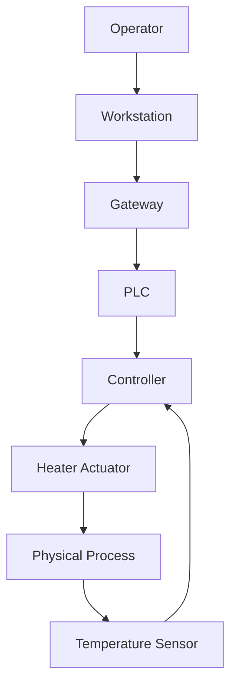
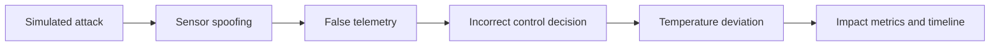

# DT-CyberTwin

What happens to the system after a successful attack?

DT-CyberTwin is a deterministic, discrete-time cyber-physical simulation. Its reference scenario models an industrial temperature-control loop and records how simulated sensor spoofing can change controller decisions and cause an unsafe temperature excursion. It is a simulation only; it does not connect to or control real industrial equipment.

## Architecture





## Requirements

- Python 3.12+
- Install project dependencies with `python -m pip install -e '.[dev]'`

## Run tests

```bash
pytest -q
```

## Run the API

From this repository directory:

```bash
uvicorn main:app --app-dir backend --reload
```

Open `http://127.0.0.1:8000/docs` for the interactive API docs.

## Endpoints

- `GET /health` — health check
- `GET /twin` — reference graph nodes and edges
- `POST /simulations/industrial-temperature` — run the deterministic temperature scenario

Example request body:

```json
{
  "steps": 12,
  "attack": true,
  "attack_timestep": 2,
  "spoof_offset": -30.0,
  "initial_temperature": 25.0,
  "setpoint": 40.0,
  "safe_max": 70.0
}
```

Set `attack` to `false` to run the baseline without the simulated attack. Results include timestep telemetry, impact findings, aggregate metrics, a chronological event timeline, and final node state.

## Competition extension direction

The starter platform is intended to provide the graph, state engine, reference CPS, baseline scenario, API, and evaluation output. Competition participants can extend it with new simulated attack scenarios, detection/defense strategies, recovery policies, or impact-analysis methods. A hardened untrusted-code submission runner is a separate deployment concern and should be added before executing arbitrary participant code.


## Frontend (development)

The React + TypeScript console is in `frontend/`. It uses React Flow for the twin topology and Recharts for telemetry.

```bash
cd frontend
npm install
npm run dev
```

Open the Vite URL printed by the command (usually `http://localhost:5173`). Start the backend separately using the API instructions above. Configure `VITE_API_BASE_URL` in `frontend/.env` if the API is hosted elsewhere. Local development CORS origins can be overridden with `DT_CYBERTWIN_CORS_ORIGINS` (comma-separated origins).

The console reports safety against the configured `[safe_min, safe_max]` range; the controller setpoint is a separate target. The simulation telemetry includes both the measured temperature at the beginning of a timestep and the actual process temperature after the control action advances the process.
