# DT-CyberTwin

> **What happens to the system after a successful attack?**

*To install the project:*

```bash
git clone https://github.com/Anushree401/DT-CyberTwin
```

then, refer to [INIT.txt](INIT.txt)

Traditional cybersecurity validation can tell us whether an attack path is possible, whether a vulnerability can be exploited, or whether security controls can stop an attacker.

But it often stops at:

**“The attacker successfully compromised the system.”**

DT-CyberTwin asks the next question:

**“What happens to the system after that?”**

---

## What is DT-CyberTwin?

**DT-CyberTwin** is a stateful cyber-physical digital twin designed to simulate how successful cyberattacks evolve through a system and how those attacks affect its **operational, cyber, and physical state over time**.

Instead of treating an attack as a static attack path, DT-CyberTwin maintains a continuously evolving representation of the system.

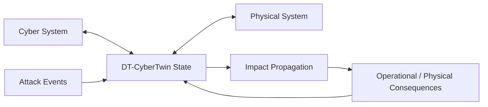

The goal is to move from:

**Attack Validation**

to:

**Attack → State Evolution → Impact → Consequence → Recovery**

---

# The Problem

Existing security assessment approaches can identify things such as:

* attack paths
* exploitable vulnerabilities
* initial access
* lateral movement
* privilege escalation
* control effectiveness

But successful compromise does not necessarily represent the final consequence.

For example:

```text
Attacker
   ↓
Initial Access
   ↓
Lateral Movement
   ↓
PLC Compromise
```

A traditional security validation may stop here.

DT-CyberTwin continues the simulation:

```text
PLC Compromise
      ↓
Sensor Manipulation
      ↓
Incorrect Controller Input
      ↓
Incorrect Actuator Command
      ↓
Physical Process Deviation
      ↓
Operational Impact
```

This makes the **post-compromise evolution of the system** the central problem.

---

# Core Idea

DT-CyberTwin combines:

* Stateful Digital Twin
* Dependency Graph
* Cyberattack Simulation
* CPS Modeling
* Time-Evolving State
* Impact Propagation
* Causal Replay
* Adaptive Intelligence

into a single simulation environment.

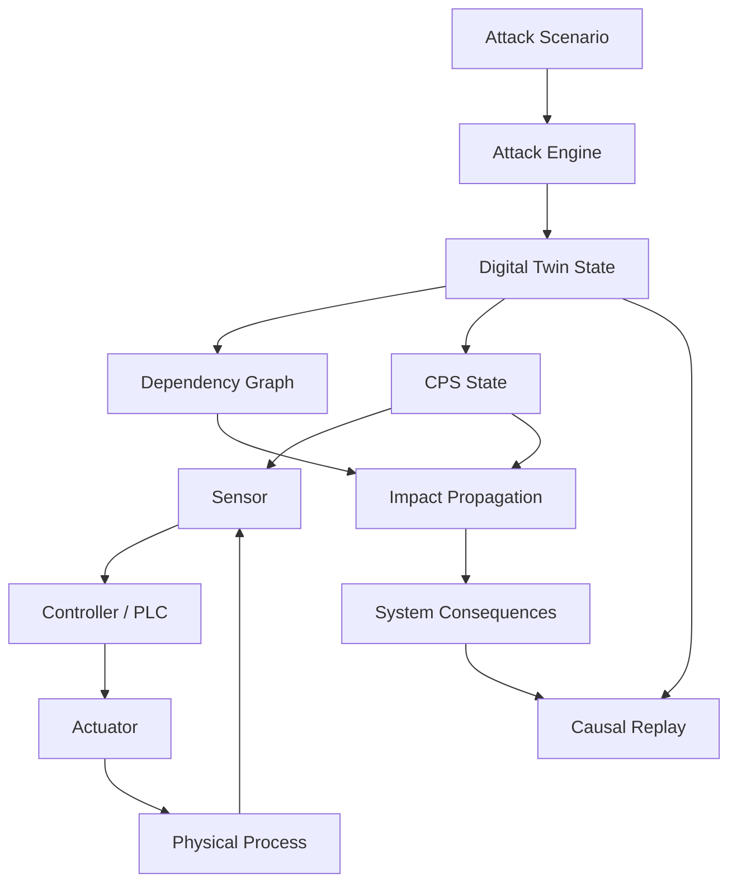

---

# Digital Twin Architecture

The digital twin represents both the **cyber system** and the **physical/control system**.

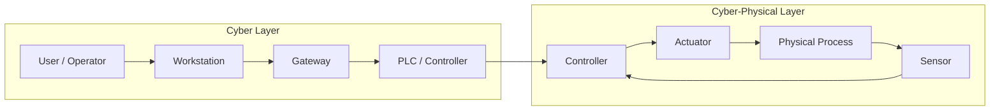

Every important component can maintain state.

Example:

```text
Node State

workstation:
    compromised = true
    privilege = user

plc:
    compromised = true
    privilege = admin

sensor:
    true_value = 80
    reported_value = 120

controller:
    target = 100
    status = unstable

actuator:
    command = HIGH
    status = active
```

---

# Cyber-Physical Feedback Loop

The CPS model is a core part of the simulation rather than a separate module.

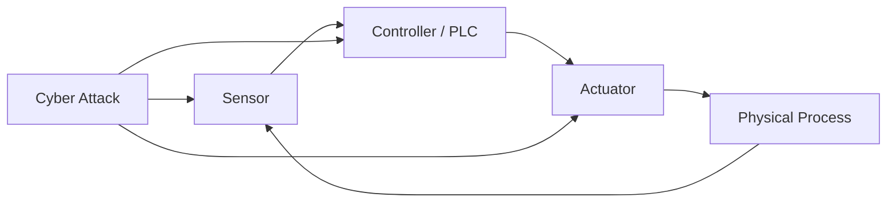

A cyber event can therefore change the physical behavior of the simulated system.

For example:

```text
Sensor Spoofing
      ↓
Incorrect Temperature Reading
      ↓
Controller Calculates Incorrect Action
      ↓
Heater Receives Incorrect Command
      ↓
Temperature Deviates
      ↓
Physical / Operational Impact
```

---

# Time-Evolving Simulation

DT-CyberTwin models the system as a sequence of state transitions.

```text
State(t+1) =
    f(
        State(t),
        Agent Actions,
        System Conditions,
        CPS Dynamics
    )
```

The simulation advances through discrete time steps.

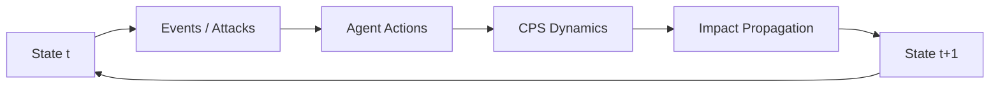

This allows the system to represent:

* compromise progression
* changing privileges
* changing network conditions
* sensor manipulation
* controller behavior
* actuator response
* physical deviation
* cascading dependencies
* recovery

---

# Dependency Graph

The digital twin represents system dependencies as a graph.

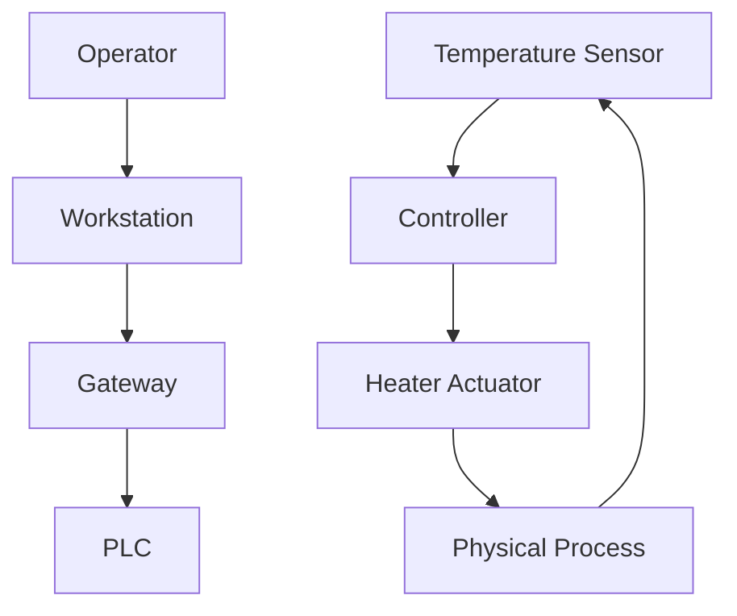

Each node and edge can contain relevant state and metadata.

Examples include:

```text
Node
├── type
├── status
├── compromised
├── privilege
├── vulnerability
├── telemetry
└── physical_state

Edge
├── dependency
├── communication
├── latency
└── reliability
```

---

# Attack Simulation

The initial implementation uses deterministic, rule-based attack scenarios.

Example:

```text
1. Compromise workstation
2. Move through gateway
3. Compromise PLC
4. Manipulate sensor telemetry
5. Trigger incorrect control action
6. Observe physical deviation
7. Measure operational impact
```

The attack engine changes the digital twin rather than simply producing an attack-path report.

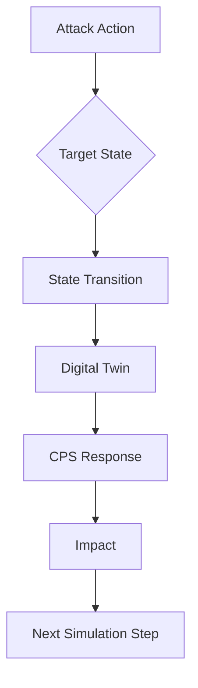

---

# Impact Propagation

The important output is not simply whether a node was compromised.

DT-CyberTwin tracks how compromise propagates through system dependencies.

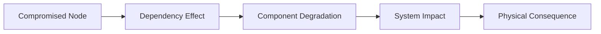

Possible measurements include:

| Layer       | Example                                         |
| ----------- | ----------------------------------------------- |
| Cyber       | compromised nodes, privilege changes            |
| Network     | latency, packet loss, communication degradation |
| Control     | controller instability, incorrect commands      |
| Physical    | temperature/process deviation                   |
| Operational | production delay, service degradation           |
| Recovery    | time to restore stable operation                |

---

# Causal Replay

Every simulation step can produce an event and state transition.

```text
t=0
Normal System

t=1
Workstation compromised

t=2
Gateway accessed

t=3
PLC compromised

t=4
Sensor telemetry manipulated

t=5
Controller response changes

t=6
Actuator command changes

t=7
Physical process deviates
```

This creates a causal timeline that can be replayed.

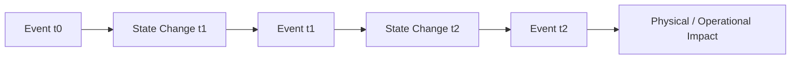

The replay layer is intended to make the simulation explainable rather than producing only a final score.

---

# Example Scenario

Consider a simplified industrial temperature-control system.

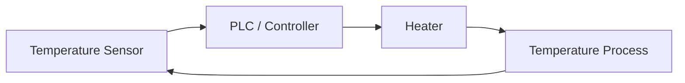

Under normal conditions:

```text
Sensor → Controller → Heater → Temperature → Sensor
```

After sensor compromise:

```text
Real Temperature
      ↓
Sensor Manipulation
      ↓
False Temperature
      ↓
Controller
      ↓
Incorrect Heater Command
      ↓
Temperature Deviation
```

DT-CyberTwin can therefore simulate not only **which component was compromised**, but also **what happened to the system because of that compromise**.

---

# Architecture

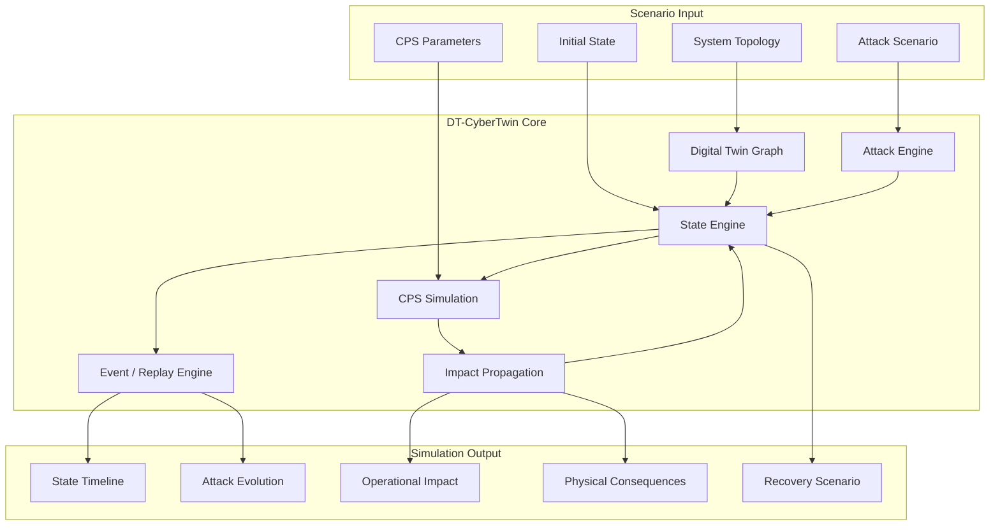

---

# Technology Stack

## Current MVP

| Layer           | Technology                  | Purpose                                  |
| --------------- | --------------------------- | ---------------------------------------- |
| Language        | Python 3.12+                | Backend + simulation                     |
| API             | FastAPI                     | Backend API                              |
| Validation      | Pydantic v2                 | State/event/scenario models              |
| Graph           | NetworkX                    | Digital twin dependency graph            |
| State           | Custom state engine         | Time-evolving system state               |
| CPS             | Custom Python models        | Sensor/controller/actuator/process       |
| Dynamics        | Custom discrete-time models | Physical/process evolution               |
| Simulation      | Custom simulation engine    | Main simulation loop                     |
| Attack Modeling | Rule-based engine           | Attack actions and transitions           |
| Impact          | Custom propagation engine   | Cyber → operational → physical effects |
| Replay          | Event/state history         | Causal replay                            |
| Storage         | JSON                        | Initial scenarios and state              |
| Testing         | pytest                      | Unit/integration testing                 |
| Environment     | uv / venv                   | Python environment                       |
| Version Control | Git / GitHub                | Source control                           |

## Planned Infrastructure

| Technology            | Purpose                                      |
| --------------------- | -------------------------------------------- |
| PostgreSQL            | Persistent application/scenario data         |
| Neo4j                 | Large-scale dependency/topology graphs       |
| TimescaleDB           | Time-series telemetry                        |
| Redis                 | Real-time simulation state / pub-sub         |
| Next.js               | Web dashboard                                |
| React Flow            | Interactive digital-twin graph               |
| Recharts              | Telemetry and impact visualization           |
| WebSockets            | Live simulation updates                      |
| Agent / RL frameworks | Adaptive attacker/defender behavior          |
| ML models             | Anomaly detection and probabilistic behavior |

---

# Project Structure

```text
backend/
│
├── models/
│   ├── node.py
│   ├── edge.py
│   ├── state.py
│   └── event.py
│
├── twin/
│   ├── graph.py
│   └── state_engine.py
│
├── cps/
│   ├── sensor.py
│   ├── controller.py
│   ├── actuator.py
│   ├── process.py
│   └── dynamics.py
│
├── simulation/
│   ├── engine.py
│   └── scheduler.py
│
├── attacks/
│   └── rules.py
│
├── impact/
│   ├── propagation.py
│   └── metrics.py
│
├── replay/
│   └── timeline.py
│
└── main.py
```

---

# Design Principle

The simulation engine should remain **deterministic, inspectable, and testable**.

Intelligent agents can operate on top of the simulation rather than replacing the underlying system model.

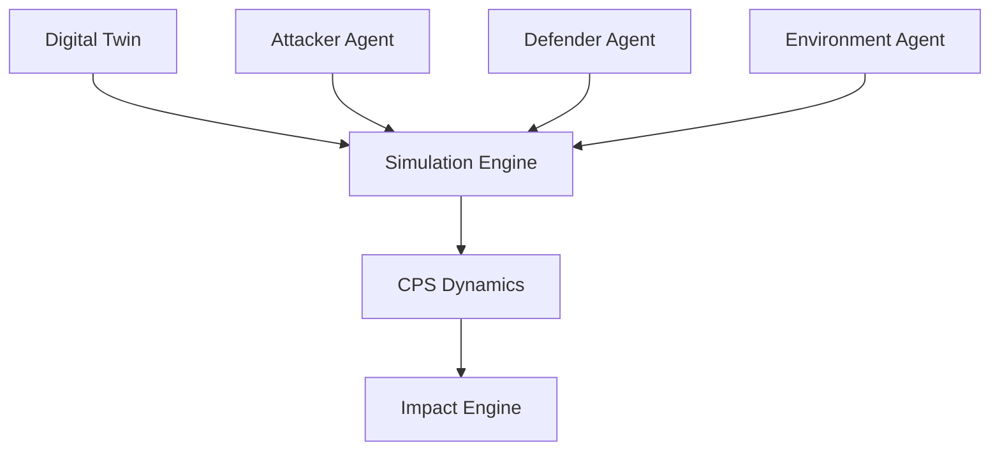

This keeps the system explainable while allowing adaptive intelligence to be added later.

---

# Development Roadmap

```text
Phase 1
├── Domain models
├── Digital twin graph
└── Initial system state

Phase 2
├── State evolution
├── Simulation loop
└── Event scheduler

Phase 3
├── CPS model
├── Sensor
├── Controller
├── Actuator
└── Physical process

Phase 4
├── Attack rules
├── Attack progression
└── State transitions

Phase 5
├── Impact propagation
├── Operational metrics
├── Physical consequences
└── Recovery

Phase 6
├── Causal replay
└── Timeline visualization

Phase 7
├── Attacker agent
├── Defender agent
└── Adaptive scenarios

Phase 8
├── Web dashboard
├── Real-time simulation
└── Interactive digital twin
```

---

# Core Research Direction

DT-CyberTwin is intended to explore how a cyber-physical system evolves **after successful compromise**.

The research direction focuses on:

* stateful cyber-physical representation
* time-evolving attack scenarios
* cyber-physical interaction
* dependency-based impact propagation
* adaptive attack behavior
* causal explanation and replay
* operational and physical consequence prediction
* counterfactual recovery analysis

---

# Vision

Traditional security assessment asks:

> **Can the attacker compromise the system?**

DT-CyberTwin asks:

> **What happens to the system after the attacker succeeds?**

The long-term goal is to create a digital twin capable of connecting:

**Cyber Events → System State → Control Behavior → Physical Response → Operational Impact**

rather than treating cybersecurity as an isolated collection of vulnerabilities and attack paths.

---

## Status

**Current focus:** Building the deterministic MVP simulation core.

**Primary target:** A working cyber-physical vertical slice demonstrating successful compromise and its evolution into measurable operational and physical consequences.

**Future direction:** Adaptive multi-agent simulation, real-time telemetry, counterfactual analysis, and interactive digital-twin visualization.
