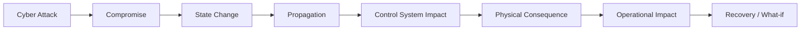
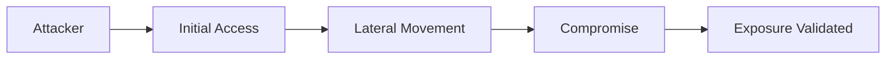
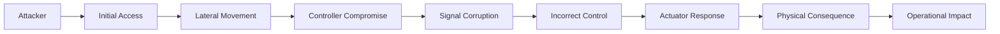
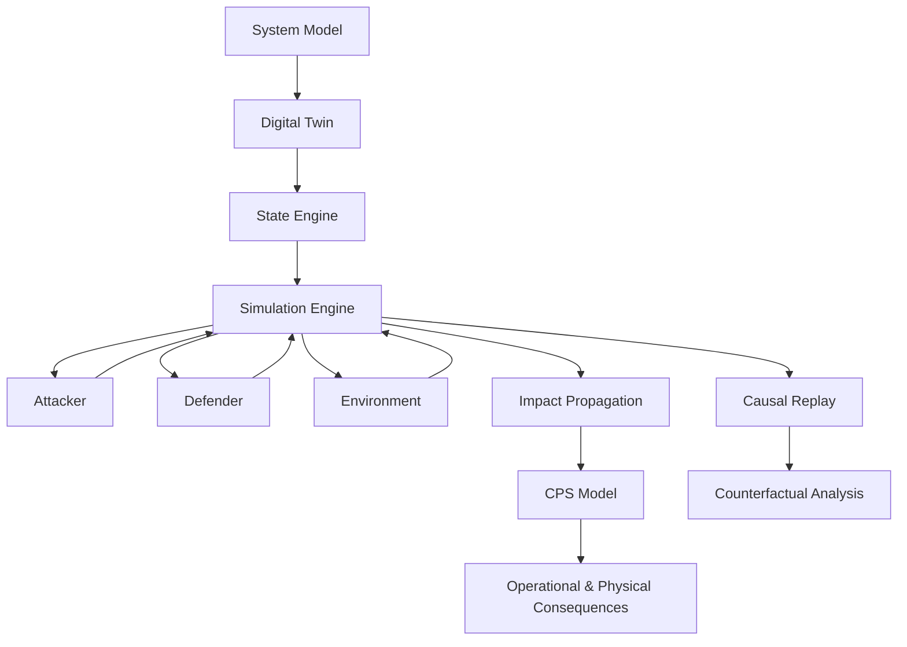
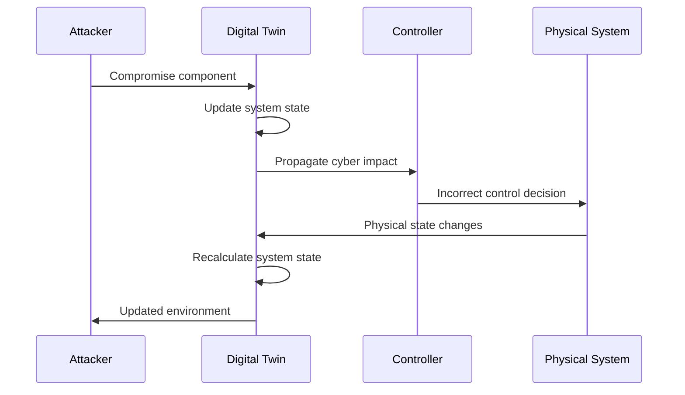
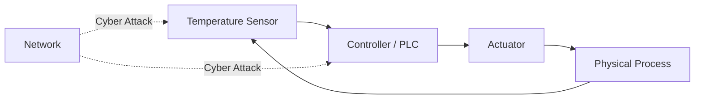
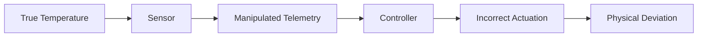
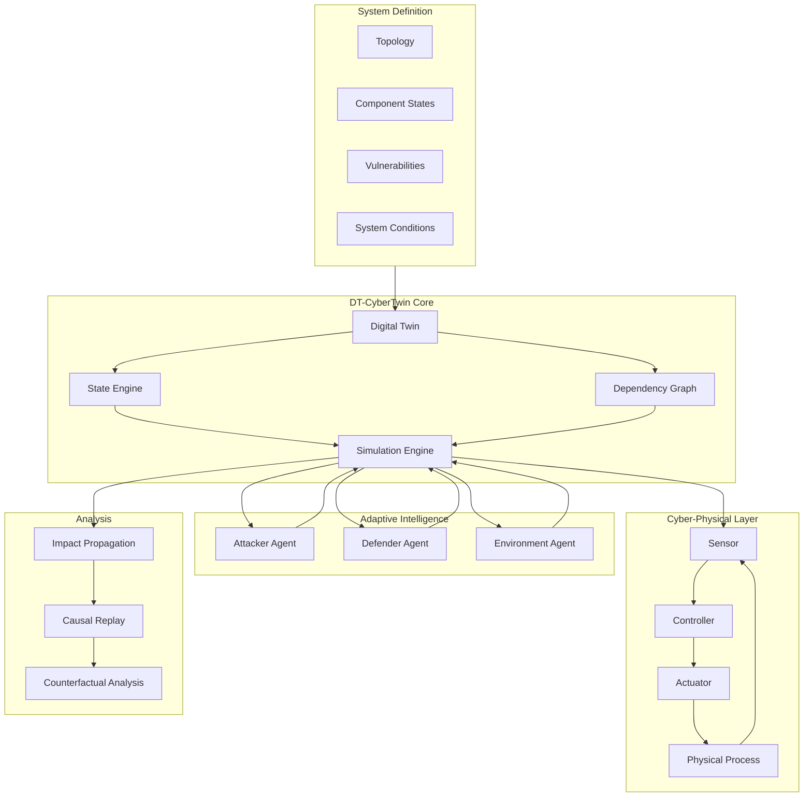
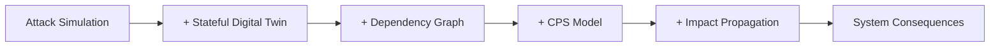
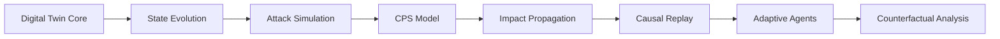

# DT-CyberTwin

> **What happens to the system after a successful attack?**

Most security validation platforms answer whether an attacker **can** compromise a system.

DT-CyberTwin asks what happens **after they do**.

It is a stateful **Cyber-Physical Digital Twin** that models how an attack evolves through interconnected systems, how system state changes over time, and how a cyber compromise can propagate into operational and physical consequences.



---

## The Gap

Traditional security validation can establish:



But the system does not stop when the attack path is validated.

DT-CyberTwin continues the simulation:



The focus shifts from:

> **Can the attack happen?**

to:

> **How will the system evolve if it happens?**

---

## What is DT-CyberTwin?

DT-CyberTwin maintains a continuously evolving digital representation of a cyber-physical environment.

It combines:

* **Stateful Digital Twin** — represents devices, services, controllers, sensors, actuators, and their current states.
* **Attack Simulation** — models attacks as evolving events rather than isolated vulnerabilities.
* **Dependency Graph** — captures relationships and propagation paths between components.
* **CPS Modeling** — connects cyber events to sensor, controller, actuator, and physical-system behavior.
* **Impact Propagation** — models cascading degradation across the system.
* **Causal Replay** — reconstructs how and why the system reached a particular state.
* **Adaptive Intelligence** — enables attacker, defender, and environment behavior to evolve with system state.



---

## A System That Evolves

The core of DT-CyberTwin is a **time-evolving system state**.



At every simulation step:

```text
state(t+1) = f(
    state(t),
    agent actions,
    system conditions
)
```

This allows DT-CyberTwin to model not only **where an attacker can go**, but **what the system becomes as a consequence**.

---

## Example

Consider a simple industrial temperature-control system:



Under normal conditions:

```text
Sensor → Controller → Actuator → Physical Process
                    ↑
                 Feedback
```

Now suppose the sensor telemetry is manipulated.



DT-CyberTwin follows the entire chain:

**Cyber event → state transition → control response → physical consequence → operational impact**

---

## Architecture



---

## What We Measure

DT-CyberTwin moves beyond a simple exposure result.

The simulation can track:

| Layer       | Example State                              |
| ----------- | ------------------------------------------ |
| Cyber       | compromise, privilege, connectivity        |
| Network     | latency, packet loss, availability         |
| System      | service degradation, dependency failures   |
| Control     | sensor deviation, controller instability   |
| Physical    | temperature, pressure, process deviation   |
| Operational | downtime, degraded functionality, recovery |

---

## The Core Idea



**DT-CyberTwin is not just asking whether a system can be breached.**

It asks:

> **Once the breach occurs, how does the system evolve?**

---

## Project Status

DT-CyberTwin is being developed as a research and competition prototype for **Digital Twins and Cyber-Physical Systems**, with the initial implementation focused on synthetic CPS environments and state-based simulation.

The initial development path is:



---

## Vision

Security validation should not end at **"compromised."**

DT-CyberTwin aims to bridge the gap between:

**attack validation**

and

**system-level consequence understanding.**

> **Simulate the attack.
> Evolve the system.
> Understand the consequence.**
